# Devbook MCP Server (`devbook-mcp`)

Official TypeScript-based [Model Context Protocol (MCP)](https://modelcontextprotocol.io/) server for [Devbook](https://github.com/leouofa/devbook), the distraction-free desktop prompt engineering workbench and studio.

This server enables AI assistants and agents (Claude Desktop, Antigravity, Cursor, and custom MCP clients) to seamlessly query, author, manage, and execute prompt templates, inspect projects, upload file attachments, and render GitHub Flavored Markdown directly through the Devbook REST API.

---

## Features

- **Full MCP Capabilities Suite**:
  - **17 Comprehensive Tools**: Full CRUD, full-text search, pin management, attachments, and markdown rendering.
  - **MCP Resources**: Direct URI inspection via `devbook://stats`, `devbook://projects`, `devbook://prompts`, and parameterized templates.
  - **Dynamic MCP Prompts**: Exposes Devbook prompt templates as native MCP prompt commands with automatic parsing and dynamic substitution of `{{variable}}` placeholders.
- **Stdio Transport**: Ultra-fast JSON-RPC 2.0 communication over standard input/output.
- **Resilient Attachment Handling**: Upload prompt context files via local filesystem paths or base64-encoded strings streamed as `multipart/form-data`.
- **OpenAPI 3.1 Contract**: Strongly typed client generated directly against Devbook's OpenAPI 3.1.0 specification with runtime `Zod` validation.
- **Zero Friction Setup**: Works out of the box with your local Devbook Rails server.

---

## Architecture Overview

```mermaid
flowchart LR
    Client["AI Agent / Desktop Client<br/>(Claude, Antigravity, Cursor)"]
    Stdio["Stdio Transport<br/>(JSON-RPC 2.0)"]
    MCPServer["Devbook MCP Server<br/>(@modelcontextprotocol/sdk)"]
    APIClient["Typed DevbookClient<br/>(Node native fetch)"]
    DevbookAPI["Devbook Rails API<br/>(http://localhost:3000/api/v1)"]

    Client <-->|MCP Protocol| Stdio
    Stdio <--> MCPServer
    MCPServer -->|Tools / Resources / Prompts| APIClient
    APIClient <-->|REST JSON & Multipart| DevbookAPI
```



---

## Quickstart

### Prerequisites

- **Node.js**: `v18.0.0` or higher (recommended: Node 20+)
- **Devbook**: Running locally (default: `http://localhost:3000`)

### Installation & Build

```bash
# Clone repository
git clone https://github.com/leouofa/devbook-mcp.git
cd devbook-mcp

# Install dependencies
npm install

# Build the TypeScript distribution
npm run build
```

---

## Configuration

The server can be configured via environment variables or command-line arguments:

| Option | Environment Variable | CLI Flag | Default | Description |
| :--- | :--- | :--- | :--- | :--- |
| **API URL** | `DEVBOOK_API_URL` | `-u, --url <url>` | `http://localhost:3000` | Devbook API base URL |
| **API Key** | `DEVBOOK_API_KEY` | `-k, --api-key <key>` | *(none)* | Optional Bearer token for authentication |
| **Timeout** | `DEVBOOK_TIMEOUT_MS` | `-t, --timeout <ms>` | `30000` | HTTP request timeout in milliseconds |
| **Prompt Sync** | — | `--no-sync` | `true` | Eagerly register saved Devbook prompts at startup |

---

## Client Integration Guides

### 1. Claude Desktop

Add `devbook` to your `claude_desktop_config.json` (`~/Library/Application Support/Claude/claude_desktop_config.json` on macOS):

```json
{
  "mcpServers": {
    "devbook": {
      "command": "node",
      "args": ["/absolute/path/to/devbook-mcp/dist/index.js"],
      "env": {
        "DEVBOOK_API_URL": "http://localhost:3000"
      }
    }
  }
}
```

### 2. Antigravity IDE

Add to your local MCP server configuration in Antigravity (`~/.gemini/antigravity/mcp.json` or project settings):

```json
{
  "mcpServers": {
    "devbook": {
      "command": "node",
      "args": ["/Users/leonid/src/devbook-mcp/dist/index.js"],
      "env": {
        "DEVBOOK_API_URL": "http://localhost:3000"
      }
    }
  }
}
```

### 3. Cursor

Add to your `.cursor/mcp.json`:

```json
{
  "mcpServers": {
    "devbook": {
      "command": "node",
      "args": ["/absolute/path/to/devbook-mcp/dist/index.js"],
      "env": {
        "DEVBOOK_API_URL": "http://localhost:3000"
      }
    }
  }
}
```

---

## Available MCP Primitives

### 🛠️ MCP Tools

| Tool | Description | Key Parameters |
| :--- | :--- | :--- |
| `devbook_list_projects` | Search and list project workspaces | `q` (query), `limit`, `offset` |
| `devbook_get_project` | Get project details and prompt index | `id` |
| `devbook_create_project` | Create a new project workspace | `name`, `description` |
| `devbook_update_project` | Update project name or description | `id`, `name`, `description` |
| `devbook_delete_project` | Delete a project | `id` |
| `devbook_list_prompts` | Search & filter prompts across scopes | `q`, `project_id`, `scope` (`standalone`), `pinned`, `limit`, `offset` |
| `devbook_get_prompt` | Retrieve prompt Markdown body & metadata | `id`, `render_markdown` |
| `devbook_create_prompt` | Create a prompt (in a project or standalone) | `title`, `body`, `project_id`, `pinned`, `pinned_position` |
| `devbook_update_prompt` | Edit prompt content, project, or pin | `id`, `title`, `body`, `project_id`, `pinned`, `pinned_position` |
| `devbook_delete_prompt` | Delete a prompt permanently | `id` |
| `devbook_toggle_pin` | Toggle sidebar pin status for a prompt | `id` |
| `devbook_reorder_pinned` | Reorder sequential pinned prompts | `prompt_ids` (array of numbers) |
| `devbook_list_attachments` | List files attached to a prompt | `prompt_id` |
| `devbook_upload_attachment` | Attach files (paths or base64) to prompt | `prompt_id`, `files` (`path` or `content_base64` + `filename`) |
| `devbook_delete_attachment` | Purge an attachment from a prompt | `prompt_id`, `attachment_id` |
| `devbook_render_markdown` | Render GFM into sanitized HTML | `text` |
| `devbook_get_stats` | Inspect platform counts & metrics | *(none)* |

### 📚 MCP Resources

| URI Pattern | MIME Type | Description |
| :--- | :--- | :--- |
| `devbook://stats` | `application/json` | Workbench metrics (total prompts, pinned prompts, projects, attachments) |
| `devbook://projects` | `application/json` | Index list of all project workspaces |
| `devbook://projects/{id}` | `application/json` | Project detail including its prompt list |
| `devbook://prompts` | `application/json` | Index list of all prompt scratchpads and templates |
| `devbook://prompts/{id}` | `text/markdown` | Full prompt Markdown body with metadata YAML frontmatter |

### 💬 MCP Prompts (Prompt Templates)

- **`devbook_execute_prompt`**: Dynamically loads any Devbook prompt by ID and populates `{{variable}}` placeholders from a variables JSON dictionary.
- **`devbook_author_prompt`**: Interactive guide that assists agents and users in authoring structured prompts with dynamic placeholders.
- **Dynamic Prompts (`devbook_<id>_<slug>`)**: On startup, saved Devbook prompts are automatically discovered, variables are extracted from the template body, and exposed as first-class typed MCP prompts (e.g., `devbook_5_project_bootstrap`).

---

## Development & Testing

```bash
# Regenerate TypeScript types from openapi.json
npm run typegen

# Typecheck with TypeScript
npm run typecheck

# Run unit and integration tests (Vitest)
npm test

# Build production bundle
npm run build
```

---

## License

This project is licensed under the MIT License.
